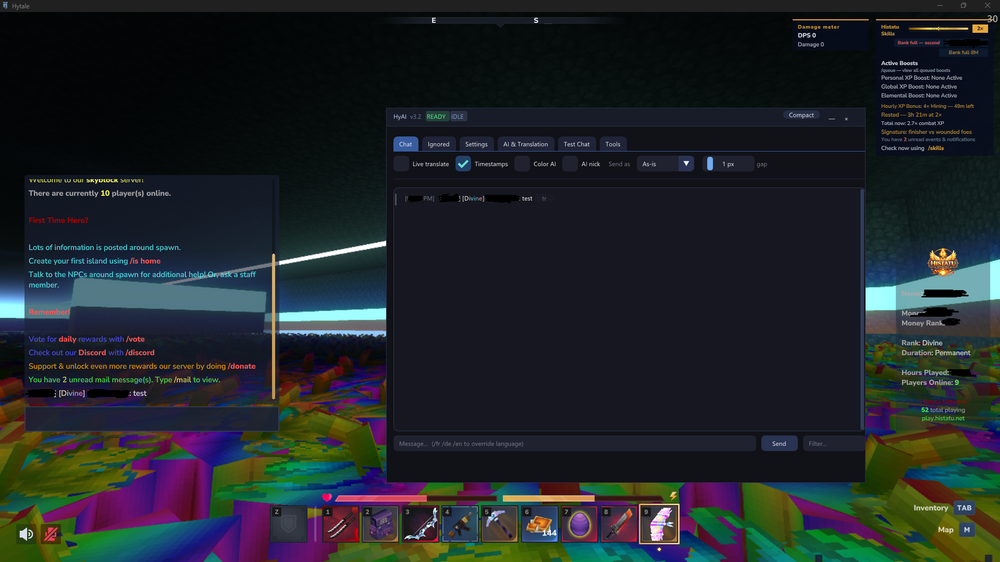

# HAI

AI-powered chat bot + live translator for Hytale (Windows DLL overlay).

## Features
- Live chat logger with colored formatting
- AI replies (Ollama or any OpenAI-compatible endpoint)
- Tools: mob/item lookup, reminders, web search, time, etc.
- Live translation, private encrypted messages, chat minigames
- Fully configurable wake words, bot name, and system prompt

## Requirements
- Windows 10/11
- Visual Studio 2022 (or Build Tools) + vcpkg
- Ollama **or** any OpenAI-compatible API

## Quick Start
1. Build the project (`x64/Release`)
2. Copy the DLL + the `data` folder next to your Hytale client
3. Edit `bot_settings.txt` (created on first run) and set:
   - Your in-game name
   - Bot name / wake word
   - Ollama model or OpenAI key
4. Inject / load the DLL

## Configuration
All settings live in `bot_settings.txt`.  
System prompt lives in `CONTEXT.md` (next to the DLL).

## Disclaimer
This is an unofficial third-party tool. Use at your own risk.  
Respect the game’s Terms of Service and anti-cheat rules.

## Showcase

